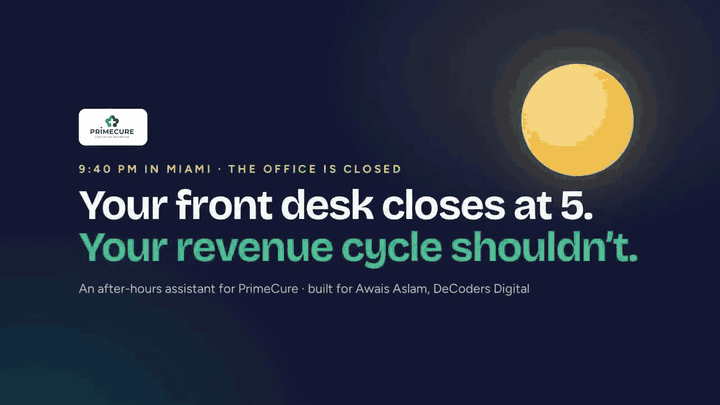
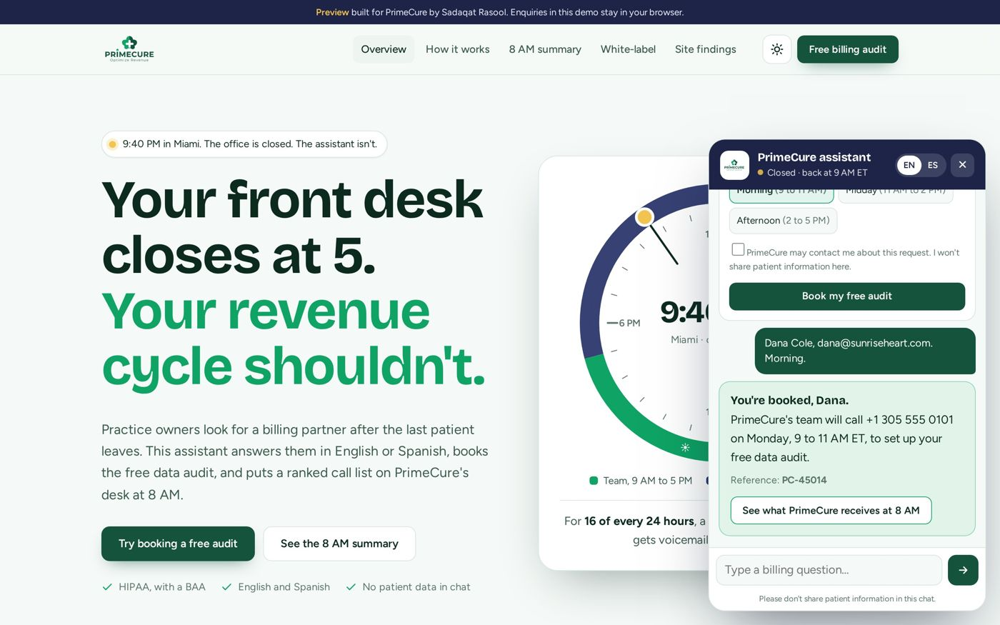
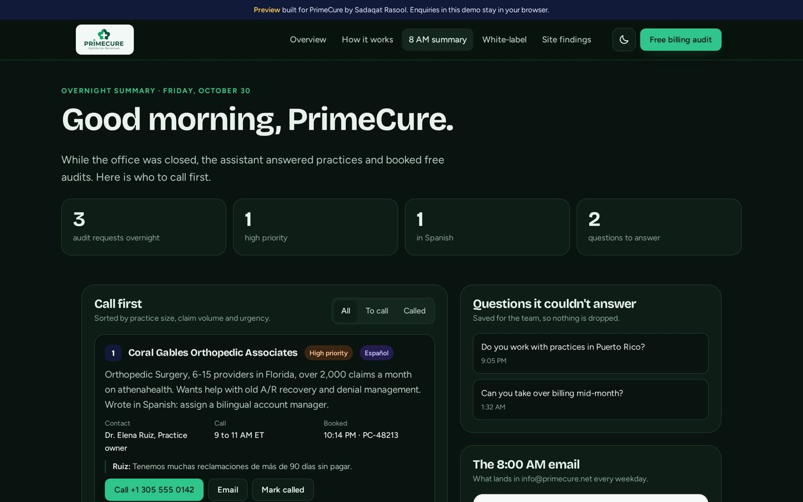
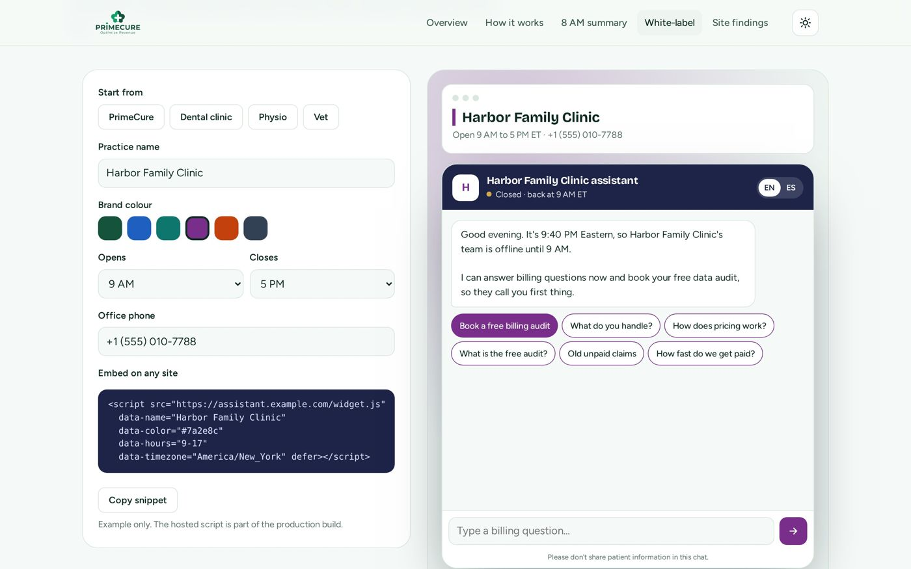

# 🌙 After-Hours AI Assistant for Lead Capture

**An assistant that answers prospects in English or Spanish after the office closes, books a free consultation, and has a ranked call list ready for the team at 8 AM. Built for a US medical-billing company.**

▶️ **[Watch the 74-second walkthrough](media/walkthrough.mp4)** · 🔗 **[Open the live preview](https://primecure-after-hours-preview.vercel.app/)**

## The problem

Practice owners look for a billing partner in the evening, when the office is closed. Those leads went to voicemail and were lost by morning.

## What it does

- **Answers any hour, in English or Spanish:** questions about billing, credentialing and pricing, from the company's own information
- **Books a free billing audit** straight from the conversation
- **Morning call list:** every overnight lead ranked by priority, with the reason, ready at 8 AM
- **White-label builder:** the same assistant can carry another company's name, colours and logo in minutes
- Light and dark themes, works on phones, **no patient data in the chat**

  
  
  

## Quality

- Full booking flow tested on phone and desktop with Playwright
- 0 accessibility errors in automated checks
- Office-hours logic follows the client's time zone, with an override for walkthroughs

**Keywords:** AI assistant, AI chatbot for lead generation, after-hours answering, appointment booking bot, bilingual chatbot, medical billing, white-label chatbot, Next.js, React, LLM

---

### Want something like this for your business?

**[Sadaqat Rasool](https://sadaqatrasool.vercel.app)**, Full-Stack & AI Software Engineer (Next.js · React · Node.js · Python · LLMs)

[Portfolio](https://sadaqatrasool.vercel.app) · [LinkedIn](https://www.linkedin.com/in/sadaqatrasool/) · [Email](mailto:sadaqatrasoolmsr@gmail.com) · Open to remote roles and client projects

This is a showcase repository. The source code belongs to client projects and stays private; this page shows what was built and how.

